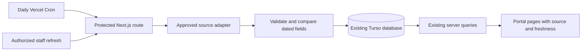

# WOS Guru State 3496: retrieval and integration feasibility

This report records the initial research state. The project owner subsequently approved implementation. See [the implemented integration and deployment instructions](../wosguru-integration.md); third-party redistribution permission remains unverified.

Reviewed **2 November 2026, America/La_Paz**; successful HTTP observations occurred on **3 November 2026 UTC**. This is a research result and proposed implementation plan. No application routes, UI, dependencies, schema, seed data, database, or deployment were changed.

## Decision

**Retrieval is technically feasible; unattended production reuse is conditional on permission.** A normal anonymous HTTP GET returned the State 3496 page, and one browser-facing JSON endpoint returned structured player data. Browser automation is unnecessary for the inspected content. However, the Terms prohibit bulk scraping and substantial republication without permission, and a state-page request initially received a capacity-related `429`.

Recommend requesting a licensed, narrowly scoped feed or export from WOS Guru's operator, Timeslice LLC, before building synchronization. Continue using staff-maintained portal data in the meantime. If the operator permits only HTML collection, a small daily server-side importer is possible, with explicit field ownership, timestamps, and failure handling. Do not treat the discovery of an anonymous endpoint as a reuse license or a stable API contract.

## What was inspected

- Local instructions, `package.json`, `bun.lock`, installed package metadata, `README.md`, Next.js/Drizzle/TypeScript configuration, middleware, public data queries, home page, admin resource registry/API, schema, migrations, and seed documentation/generator/fixture.
- Public [State 3496 source](https://wosguru.com/state/3496), [robots.txt](https://wosguru.com/robots.txt), [Terms](https://wosguru.com/terms), [Privacy](https://wosguru.com/privacy), [About](https://wosguru.com/about), and [deployed portal homepage](https://state3496.vercel.app).
- Inline source scripts and one exact GET URL advertised by those scripts. No login, private alliance pages, Pro content, player detail crawling, pagination crawl, form submission, or telemetry POST was used.

The web research service could not consistently retrieve the state page or policies. Direct HTTPS requests succeeded after sandbox network permission. One delayed state-page retry honored `Retry-After`; there was no user-agent spoofing, CAPTCHA solving, cache-busting, proxy rotation, origin discovery, or other access-control workaround. No browser/HAR capture was available: request construction below comes from inspection of downloaded source plus the explicitly identified endpoint test.

Raw HTML/JSON was kept in the local temporary directory `wos3496-wosguru-research`, outside the repository. The repository contains only this report, a small [evidence summary](wosguru-state-3496-evidence.json), and an [offline inspection script](inspect-wosguru-state-3496.mjs). Raw copies are temporary research material, not production fixtures or redistribution artifacts.

## Repository and deployed architecture

| Area          | Verified configuration                                                                                    | Integration implication                                                                                            |
| ------------- | --------------------------------------------------------------------------------------------------------- | ------------------------------------------------------------------------------------------------------------------ |
| Framework     | Next.js 15 App Router / React 19 / TypeScript; locally installed Next 15.5.28 and React 19.3.1            | The Vite premise is outdated. Use existing route handlers and server queries.                                      |
| Tooling       | Bun lockfile; `next dev/build/start`; Bun 1.4.2 available                                                 | Keep Bun for installation and scripts. `bun.exe` works around this workstation's blocked PowerShell shim.          |
| Persistence   | Drizzle + `@libsql/client`; local SQLite fallback, hosted Turso/libSQL supported                          | Reuse Turso in production; no new database service is needed.                                                      |
| Reads         | `app/lib/actions.ts` queries Drizzle on the server; `getStateSettings()` calls `noStore()`                | Portal requests can read persisted imported values without contacting WOS Guru. Cache policy would be explicit.    |
| Editing       | Staff-authorized `app/api/admin/[resource]/route.ts`; generic admin resources include game/ranking tables | Preserve editorial ownership. Do not reuse an unprotected generic import endpoint.                                 |
| Existing data | `docs/seed-data.md` credits an indexed Korean WOS Guru page reviewed 29 October                           | This is a possible refresh of an existing historical source, not an empty application needing a new data platform. |
| Public UI     | Shared tactical-dark semantic tokens, JetBrains Mono / Work Sans                                          | Any later attribution/freshness display should use existing components and tokens.                                 |

The deployed homepage returned `200`, Next.js headers/assets, and figures matching the existing historical fixture, including top-100 power **46.10B** and SvS rating **1558**. This confirms the deployed rendering technology, not the production database provider, Vercel plan, runtime settings, or deployed Git revision; those were not available. No secrets or production database were inspected.

The seed currently contains six alliance tags, eleven players, eleven SvS results, three presidency appointments, and tentative events. Running it again restores fixed values; **it is not an appropriate synchronization mechanism**. Existing seed player IDs depend on rank (`3496-player-<rank>`), and the power snapshot has one fixed ID. A live importer must not reuse either identity scheme for changing rankings.

## Inventory and possible uses

Observed on the downloaded English page, not inferred from our old fixture:

| Available information  | Coverage and limitations                                                                                                                        | Useful destination                                                                                      |
| ---------------------- | ----------------------------------------------------------------------------------------------------------------------------------------------- | ------------------------------------------------------------------------------------------------------- |
| State progression      | Opening month, displayed age, hero generation, FC tier; exact opening day is not stated                                                         | `state_settings.launchMonth`, `heroGeneration`, `fireCrystalLevel`; do not manufacture `launchDate`     |
| Ratings/ranks          | SvS, preparation, castle ratings; global and transfer-group ranks and denominators                                                              | Existing state statistic columns; preserve what each rank measures                                      |
| Aggregate leaderboards | Top-100 power, kills, Labyrinth, Transfer Score, troop/tech/gear power; top-20 power, growth, peer percentiles                                  | Existing top-100 columns cover some; additional metrics need an approved model extension                |
| Alliance directory     | Ten leading alliances: tag, full name, rounded power, members, median furnace, SvS castle wins; link to a larger list                           | `alliances` and alliance rankings; members/median furnace need additional fields or source metadata     |
| Player leaderboards    | Top 50 power; top ten kills, Labyrinth, Transfer Score, troops, tech, Chief Gear, Chief Charms; names, tags, furnace levels, some profile links | `players`, `ranking_snapshots`, `ranking_entries`; supported metrics currently only `power` and `kills` |
| Furnace distribution   | Twelve bands, level counts, covered population, median and highest tier; expandable paginated members                                           | Aggregate progression display; no current dedicated histogram table                                     |
| SvS history            | Eleven cycles, opponents/dates, attack/defense, result and rating changes; rating chart and some castle occupation durations                    | `svs_cycles`, timeline; rating changes/occupation duration are not prep or battle scores                |
| Castle history         | Twenty-four dated holders, alliance/name, president/Supreme/foreign occupation labels                                                           | `rotation_slots`, timeline; exact term end, local membership, and identity may be unknown               |
| Upcoming events        | SvS, transfer window, generation/FC unlocks, predicted Frostdragon schedule                                                                     | `calendar_events`, transfer windows and timeline; distinguish confirmed dates from estimates            |
| Transfers              | Group 14 range, rank/neighbors; twenty detected arrivals and thirty departures since 11 October                                                 | Existing transfer group; movement history would require a separate approved model                       |
| Next-SvS forecast      | Likely opponents, estimated prep/castle win probabilities, draw/prep/battle stages                                                              | Optional contextual links; these are WOS Guru estimates, not confirmed matchups                         |
| Context                | Nearby-age states, share card, public links and Pro Intel promotion                                                                             | Link to source rather than copying charts, artwork, forecasts, or paid reports                          |

The roster describes players in the state's strongest alliances plus strong outsiders. It is **not a census**: observed coverage was **1,013 players**. Missing rows do not mean a player left the state. The top ten alliances do not establish the full alliance count, NAP membership, farm relationships, recruitment capacity, or leadership. Member count does not establish open spots.

Examples of drift: the current source shows top-100 power **46.0B**, global SvS rank **562/3939**, and first player power displayed as **927M**. Our fixture has **46.1B**, **596/3998**, and **883M** respectively. These compare snapshots with different dates; they are not a verified continuous time series. Different sections also have different freshness.

Information not established by this source includes portal staff roles, state rules, Discord contacts, recruiting decisions, confirmed operations assignments, farm ownership, and detailed preparation/battle scores. Those should remain locally managed.

## HTTP, structure, endpoints, and pagination

The state page is server-rendered HTML behind Cloudflare, with an Express header. Important sections use stable-looking IDs such as `alliances`, `players`, `furnace`, `svs`, `castle`, `coming`, `moves`, `group`, and `roster`. Tables and collapsed `<details>` contain much of the data; SVG embeds the rating chart. Standard HTTP and HTML parsing can retrieve that content without executing JavaScript.

| Source or endpoint                                       | Evidence                                           | Result / contract                                                                                                                                                       |
| -------------------------------------------------------- | -------------------------------------------------- | ----------------------------------------------------------------------------------------------------------------------------------------------------------------------- |
| `GET /state/3496`                                        | Direct anonymous request                           | Initial `429`; one delayed retry returned `200`, 252,496 bytes. Main figures and first roster page are already in HTML.                                                 |
| `script[type="application/json"].fcc-data`               | Inspected embedded JSON                            | Furnace band counts, numeric levels and UI configuration. It advertises the furnace endpoint but does not embed all players.                                            |
| `GET /api/state/3496/furnace?lang=en&band=fc8&page=1`    | **One live GET validated**; no cookies/token       | `200 application/json`, 2,792 bytes; keys `rows`, `total`, `page`, `per`, `pages`. Sample: total 83, page 1, per 50, pages 2, 50 rows.                                  |
| `GET /api/state/3496/players?lang=en&q=<query>&page=<n>` | `#roster[data-api]` and inline `fetch()` inspected | **Not requested separately.** UI expects JSON containing `html`, `nav`, `total`, `page`. This is an HTML-fragment transport, not necessarily normalized player objects. |
| `/state/3496?pq=<query>&pp=<n>#roster`                   | Inspected links and history handling               | Server-rendered fallback/search URL. Initial UI shows 1–50 of 1,013 and 21 pages. No subsequent pages were fetched.                                                     |
| `application/ld+json`                                    | Parsed locally                                     | Breadcrumb and WebPage metadata, not a complete state statistics feed.                                                                                                  |
| `POST /api/stateview`                                    | Inline `sendBeacon()` inspected                    | View telemetry, not a data source; never invoked.                                                                                                                       |

Furnace row tuples are `[name, allianceTag, numericFurnaceLevel, exactPower, playerPath]`. The first sampled tuple maps to Chief ID `586973880`, furnace `FC8` (numeric level `70`), power `926937228`. The same player is rounded to `927M` in the HTML. A future adapter should retain both precision and identity provenance rather than turning a rounded display number into an exact measurement.

The furnace UI loads a band's page on expansion and sends `band` and `page`. The roster debounces search by 200 ms, filters using `q`, paginates on click, and updates `pq`/`pp` in history. Both fetch calls explicitly use `credentials: 'omit'`. Furnace page size is 50; the inspected roster also displays 50. There was no attempt to vary undocumented limits or enumerate all records.

No documented developer API, versioned schema, API key program, bulk export, rate quota, SLA, or general state-summary JSON endpoint was verified. Do not infer nonexistent `/api/states` or similar routes. These are endpoints used by the public website with no demonstrated compatibility guarantee. The tested JSON response had no `Access-Control-Allow-Origin`; cross-origin browser access from our portal is not established. A production adapter belongs on the server regardless.

## Reliability, rate limits, and freshness

- The `429` response included `Retry-After: 60`, `X-Origin-Proxy: worker-cap`, `Cache-Control: no-store`, and a brief busy message. The later normal request succeeded. This is evidence of capacity/load shedding, not proof of a particular per-client quota or CAPTCHA system.
- The successful state page had `Cache-Control: public, max-age=600`, `CF-Cache-Status: HIT`, `Age: 2345`, and `X-Edge-Cache: STALE`. The edge could therefore serve older content beyond the nominal cache freshness. The furnace endpoint had a 600-second cache directive and an ETag; conditional request support was not tested.
- Page `<time>` attributes show `2026-10-29T16:36:58.488Z` / `2026-10-29`, while leaderboard ranks say “as of 3 Nov” and JSON-LD `dateModified` says `2026-10-10`. Fetch time and JSON-LD modification date cannot stand in for every metric's observation date.
- Other requests through the web research service failed or were rate-limited. One successful sample does not establish availability from Vercel's IPs or regions. No access-control challenge was encountered on the successful direct requests; policies may still change.
- HTML class names, tuple positions, pagination, localization, undocumented endpoint behavior, renamed alliances, incomplete coverage and changing game schedules all create maintenance risk. Prefer raw JSON numbers and dated identifiers over translated display text. Do not silently accept zero rows after a parser change.

## Collection rules and legal feasibility

The [Terms](https://wosguru.com/terms), last updated **22 August 2026**, prohibit using the site “to scrape it in bulk” and say “Do not republish substantial portions elsewhere without permission.” They expressly welcome linking. These restrictions make a mirrored roster or repeated multi-page harvest inappropriate without a written agreement. They do not expressly define a permitted volume or grant a data-republication license. The bounded research requests and offline metadata proof below are not a production-use authorization.

[robots.txt](https://wosguru.com/robots.txt) returned `200`. It allows live AI research/search agents and general crawling, disallows model-training crawlers, and restricts named high-load bots on state/player/alliance pages. The wildcard group allows `/` but excludes `/*?new=` and `/state/*/vs`. Its comments describe recent bot traffic impairing the site. Do not assume the wildcard group overrides a more specific matching agent group. No crawl delay or numeric API quota was published there. Respecting robots is necessary for this proposal, but [RFC 9309](https://www.rfc-editor.org/rfc/rfc9309.html#section-1) explains that robots rules are not access authorization or a reuse license.

The [Privacy policy](https://wosguru.com/privacy), updated **14 October 2026**, describes optional Google sign-in and password-gated alliance pages, with signed access cookies. No credentials, private pages, shared passwords, or Pro reports are needed for the inspected public content. Purchasing the advertised Pro subscription would not establish API or redistribution rights.

Legal considerations to resolve before ongoing imports:

1. **Permission/contract:** Ask Timeslice LLC, via the public contact `dave@wosguru.com`, for permission to retrieve and republish specified State 3496 fields, allowed endpoints, frequency, retention, attribution, player-level coverage, commercial use if relevant, and a revocation process. Ask whether it can provide a small JSON/CSV feed. No message was sent during this work.
2. **Copyright and database rights:** Factual numbers differ from copied writing, graphics, and database compilations. The [U.S. Copyright Office](https://www.copyright.gov/help/faq/faq-protect.html) distinguishes facts from protected expression; this does not settle contractual restrictions or database rights. Where applicable, [EU Directive 96/9/EC, Article 7](https://eur-lex.europa.eu/legal-content/EN/ALL/?uri=CELEX%3A31996L0009) can also restrict substantial or repeated systematic extraction. Attribution alone is insufficient permission.
3. **Player privacy:** Game names and Chief IDs can relate to identifiable individuals. If GDPR applies, pseudonymous identifiers may still be personal data, as explained by the [European Commission](https://commission.europa.eu/law/law-topic/data-protection/information-business-and-organisations/application-gdpr_en). Prefer state/alliance aggregates initially; agree on a player-data purpose, appropriate legal basis, retention and correction/removal process before republishing a roster. Do not join game accounts to portal authentication profiles by name.
4. **Jurisdiction and rights chain:** Applicable law, operator/user locations, portal commercial status, source collection authority and game-publisher restrictions were not established. This is a legal risk assessment, not a jurisdiction-specific conclusion that scraping is lawful. A source agreement should address its right to license the fields supplied. Retain the unofficial-game disclaimer and avoid copying game artwork.

The existing historically sourced fixture is not evidence of permission for future collection or republication. Include its reuse in the permission discussion. Manual copying of substantial WOS Guru content would not avoid these restrictions.

## Minimal proof of concept

[inspect-wosguru-state-3496.mjs](inspect-wosguru-state-3496.mjs) uses only built-in filesystem APIs. It reads an already saved public HTML file, validates the canonical state URL, inspects embedded JSON, counts furnace coverage and SvS cycles, and optionally checks the single saved FC8 response. It emits an aggregate summary plus one example player mapping. It does not make HTTP requests, execute source scripts, follow links, paginate, import application modules, or write to a database.

Run against the temporary files from this investigation:

```powershell
$researchDir = Join-Path $env:TEMP 'wos3496-wosguru-research'
bun.exe docs/research/inspect-wosguru-state-3496.mjs "$researchDir/state-retry.html" "$researchDir/furnace.json"
```

After those temporary files are removed, use equivalent saved public files obtained within the source's rules; this report intentionally does not commit a full third-party HTML page or roster. The script is tied to the observed HTML and FC8 first-page contract and deliberately fails if they change. It is an offline research demonstration, not a general-purpose or deployable scraper.

Validation completed: saved real HTML + JSON **passed** (1,013 covered players, 83 FC8 players, eleven SvS cycles, one 50-row API page); the saved `429` body was **rejected with exit code 1**. No production-data extraction job was built. A full app build/database test was unnecessary because application code and dependencies were unchanged.

## Options compared

| Option                                           | Reliability and maintenance                                                             | Compliance / production fit                                               | Recommendation                                     |
| ------------------------------------------------ | --------------------------------------------------------------------------------------- | ------------------------------------------------------------------------- | -------------------------------------------------- |
| Operator-supported API/export                    | Best opportunity for stable identity, schema, dates and rate terms                      | Explicit redistribution rights required; price unknown                    | **Preferred**                                      |
| Current browser-facing JSON                      | Exact numbers and some IDs; narrower than complete state data; undocumented             | Anonymous access demonstrated for furnace only; no bulk-reuse grant       | Use only if operator approves and supports scope   |
| Server-side HTML extraction                      | Most state data in one HTTP response; rounded figures and brittle markup                | Low traffic is possible, but recurring reuse still needs permission       | Conditional fallback for a few aggregates          |
| Browser automation                               | Adds browser binaries, execution time, telemetry, UI selectors and operational failures | Does not change reuse rights or justify crossing a challenge              | Unnecessary for observed data                      |
| Staff-provided game records / authorized exports | Existing editing workflow; manual effort and data-quality checks                        | Establish contributors' authority; no dependency on WOS Guru availability | Best immediate source                              |
| Other community sites / official publisher feed  | No alternative licensed API verified in this investigation                              | Another public website has its own reuse rules                            | Evaluate only with actual documentation/permission |

## Proposed production integration, after approval



Use native `fetch`, existing Zod validation, Drizzle, and Turso. No Vite migration, browser package, queue platform or Redis service is needed for a single-state daily job. If approved HTML extraction goes beyond the narrow embedded JSON demonstration, select and pin one small HTML parser only when its benefit is justified.

**Collection and persistence.** Add a small, approved import metadata model rather than overwriting everything through `db:seed`: source identifier/URL, last attempt, last success, source timestamps by dataset, parser version, content hash/ETag, next allowed attempt, status/error category, and a database lease expiry. Store only necessary licensed payload fields, with bounded retention if keeping raw responses. Preserve the last good snapshot on fetch, schema, or consistency failures. Use a transaction for each validated dataset, not one partially populated state update.

**Identity and field ownership.** Use `players.chiefId` from an approved source ID when available, with a reviewed mapping to existing rank-based seed IDs. Do not use current rank, display name or alliance tag alone as permanent identity. Review tag/name changes and maintain a source-to-local alliance crosswalk; no immutable alliance ID was verified. `players.allianceId` is mandatory, so unknown affiliations need staging/review rather than fabricated membership. Imported public players remain separate from `profiles` and `user_roles`. Add idempotent keys for source/state/dataset/snapshot and handle corrections to the same dated snapshot transactionally.

**Mapping limits.** State aggregate columns, supported power/kills rankings and SvS results fit much of the existing schema. Confirm whether `top100Exploration` represents the source's current Labyrinth metric before mapping those differently named fields. New snapshots require distinct IDs; existing ranking entries are unique by snapshot/rank. The ranking metric enum lacks Labyrinth/Transfer Score/tech/etc. and snapshot records lack source provenance. Castle history may include foreign holders that cannot be forced into a local-alliance rotation. Do not put rating deltas into game score fields or occupation durations into an undifferentiated score. Stage unsupported fields until a minimal migration is approved.

**Editorial protection.** Allowlist machine-owned numeric/date fields and preserve local recruitment status, descriptions, contacts, rules, notes, publication choices and staff corrections. Store a freshness marker with each dataset. Missing values stay null; missing players do not trigger deletion. A partial roster or ambiguous identity should be reviewable without changing the public records. Do not convert member counts into vacancies or forecasts into confirmed events. Exclude live data from later seed resets/restoration or explicitly retire conflicting fixture rows.

**Scheduling and caching.** Propose one daily fetch only if the operator agrees. Never fetch WOS Guru per portal visitor. Serve the durable last-good data from Turso; add a separate short Next.js read cache only if portal traffic warrants it. Keep source observation time separate from fetch time, with a visible age/attribution label and an agreed stale threshold. Use conditional requests only if the approved feed supports them. Persist cooldown after `429`/`Retry-After`; stop on a login page, challenge, `401`/`403`, changed policy or invalid schema. For transient network/5xx failures use bounded later attempts with backoff, not in-function sleep loops. Retrying `429` is not a license to continue harvesting.

**Vercel behavior.** A proposed Node-runtime route, such as `/api/cron/wosguru`, would verify the bearer `CRON_SECRET`; the current guest-cookie middleware alone does not authorize it. Fail closed if the secret is missing. An atomic Turso lease prevents overlapping runs and also covers an optional staff-triggered refresh. Check this route's auth and cache behavior separately from ordinary pages. Keep source credentials and Turso tokens in server-only environment variables. Hardcode/allowlist the upstream HTTPS origin and paths, cap body sizes/timeouts, reject unexpected redirects, and validate content types and schema. Render plain escaped fields; never inject upstream HTML fragments into portal UI.

Vercel Cron invokes a production HTTP route. As currently documented, Hobby supports daily execution with timing anywhere within the scheduled hour; Pro permits more frequent scheduling. Jobs can overlap, and failed invocations are not automatically retried. See [Cron usage](https://vercel.com/docs/cron-jobs/usage-and-pricing), [management](https://vercel.com/docs/cron-jobs/manage-cron-jobs), and [quickstart](https://vercel.com/docs/cron-jobs/quickstart). One job and a database lease suffice for the proposed scope. Cron times are UTC.

Vercel functions have a read-only application filesystem and temporary scratch storage: use existing remote Turso, not `data/portal.db`, JSON files or process memory as durable storage ([runtime documentation](https://vercel.com/docs/functions/runtimes)). Keep Bun for builds/scripts; no production runtime change is required. Function time, memory and bundle limits depend on plan and compute settings ([function limits](https://vercel.com/docs/functions/limitations)); set a small per-request timeout and bounded request budget after source testing. No headless browser is needed. Verify access from the intended Vercel deployment region during an authorized pilot, and stop if blocked.

## Costs and operational limits

- **Licensing/feed cost:** Unknown; ask the operator. A Pro subscription price on the public site is not a quote for data/API licensing.
- **Infrastructure:** One 252 KB HTML response daily is approximately 7.6 MB/month before compression, plus approved endpoint requests, function overhead and database operations. Daily refresh needs no schedule upgrade solely for frequency; actual charges depend on the account's allowances and total usage. A larger roster import substantially increases request count and permission requirements.
- **Storage:** Small aggregates and bounded snapshots should fit the existing database pattern. Keep a retention limit for rankings, payloads and errors; do not assume unlimited free Turso capacity or add a paid cache service by default.
- **Maintenance:** Expect adapter fixes when markup/tuples change, reconciliation for renamed/moved players, policy checks and stale-data monitoring. These can cost more time than the compute. Browser automation would add cost without solving the identified issues.
- **Security:** Treat source data as untrusted input. Avoid arbitrary upstream URLs (SSRF), copied cookies/tokens, HTML injection, source credentials in client bundles and public refresh endpoints. Logs should contain counts/status/durations, not full rosters, session cookies or secrets.

## Implementation sequence and acceptance criteria

1. **Agree on rights and scope.** Request a supported State 3496 feed/export and written retrieval/republication terms. Start with state/alliance aggregates rather than a roster mirror. Confirm attribution, schedule, retention, history and existing-fixture reuse. This is the first external prerequisite; no contact was made.
2. **Approve the concrete integration scope.** Choose fields from the inventory, define source-versus-staff ownership, freshness targets and behavior when permission or access is withdrawn. Obtain the project owner's implementation approval before any application changes.
3. **Validate the supported contract.** With operator permission, save a small representative fixture, confirm IDs, exact units, per-dataset timestamps, pagination bounds, conditional requests, quota and Vercel-region access. Do not infer them from this one sample. Capture a permitted browser network trace only if an unresolved behavior needs it.
4. **Design the minimal migration.** Reuse existing models where semantics match; add only required provenance/import-run fields and approved missing metrics. Plan the reconciliation of rank-based seed IDs and seed conflict protection. Back up data and review the migration separately.
5. **Build an isolated adapter and dry run.** Native fetch + Zod; strict source/path/body/time limits; mapping diff, no writes by default. Verify missing IDs, rounded values, partial results, timestamp disagreement, HTML errors, schema changes and `429` behavior with local fixtures.
6. **Add transactional persistence and a protected trigger.** Atomic lease, idempotency, per-field ownership, last-good snapshot and bounded retention. Verify duplicate runs, correction of an existing snapshot, unknown affiliations and preservation of staff edits. Never use a whole-database reset.
7. **Pilot manually in preview.** Cron is production-only. Run an authorized staff preview refresh, compare with the source and current portal, inspect diffs and failure logs. Ensure the UI does not claim the whole population is covered or present estimates as game facts.
8. **Schedule and observe after release approval.** Configure one daily production cron, environment secrets, agreed request budget and stale alerts; add source/date display using the existing tactical-dark components and fonts. Rollback disables collection and preserves the last good dataset; confirm revoked access also triggers the agreed retention/removal process.

Open questions remain: source licensing scope/price, supported feed availability, rate quota, stable alliance IDs, public player-endpoint response behavior, commercial/jurisdictional applicability, source data rights, complete population coverage, and access from Vercel. None prevents proposing the above design; they prevent responsibly claiming that a production scraper is already approved or reliable.
